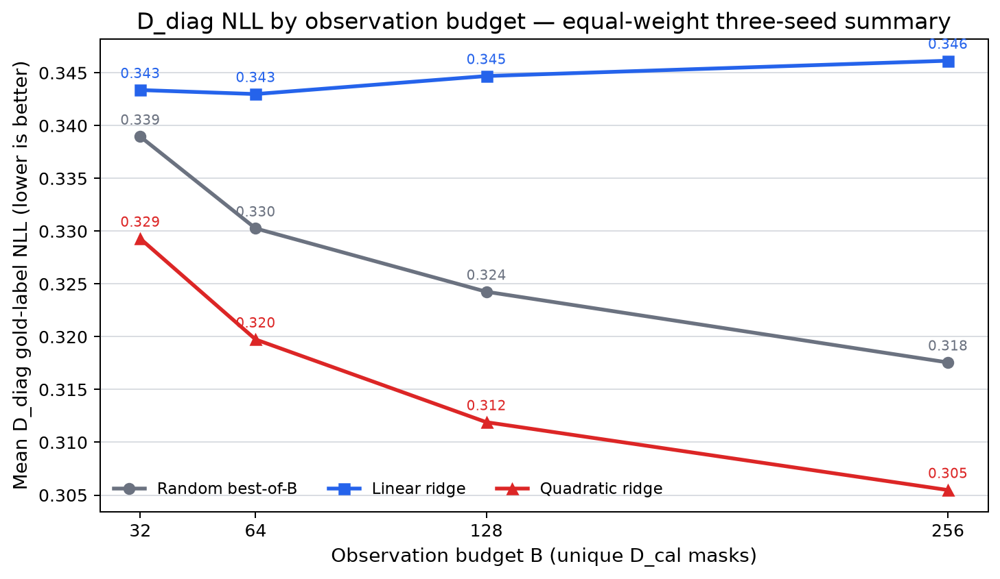
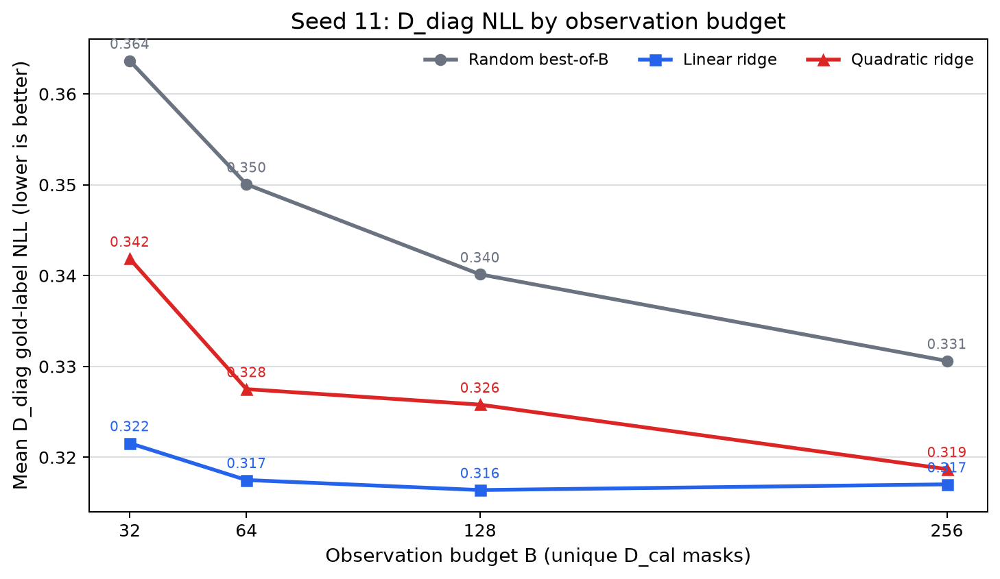
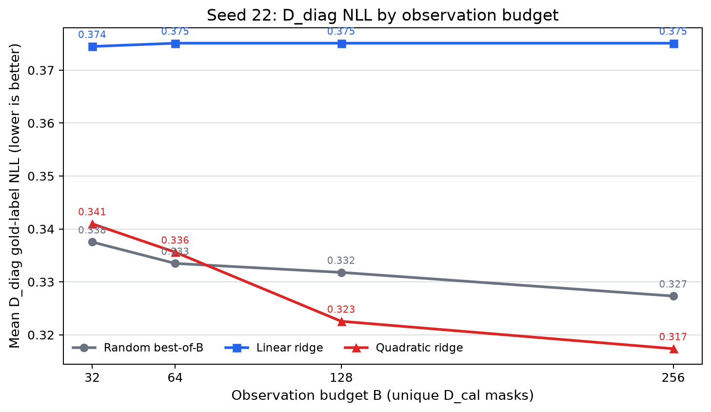
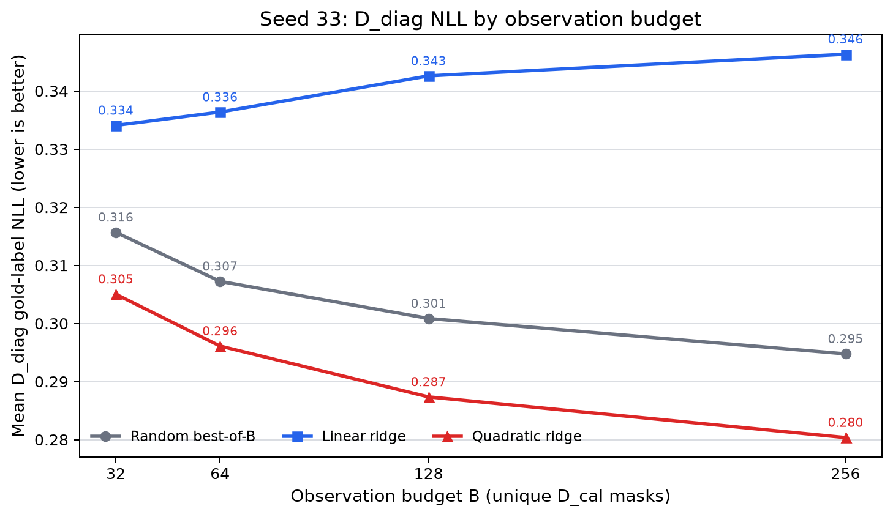
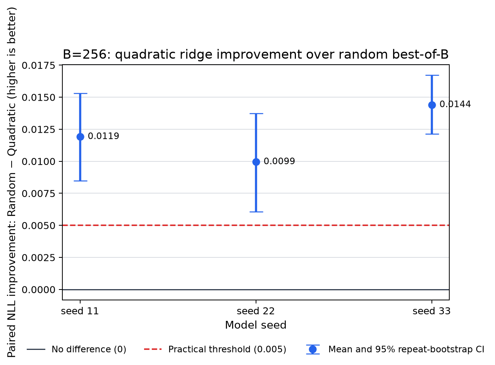
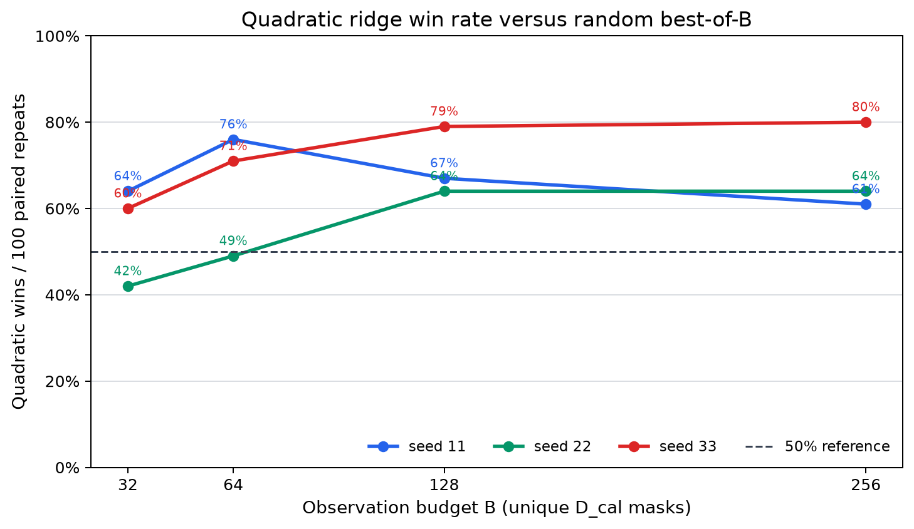
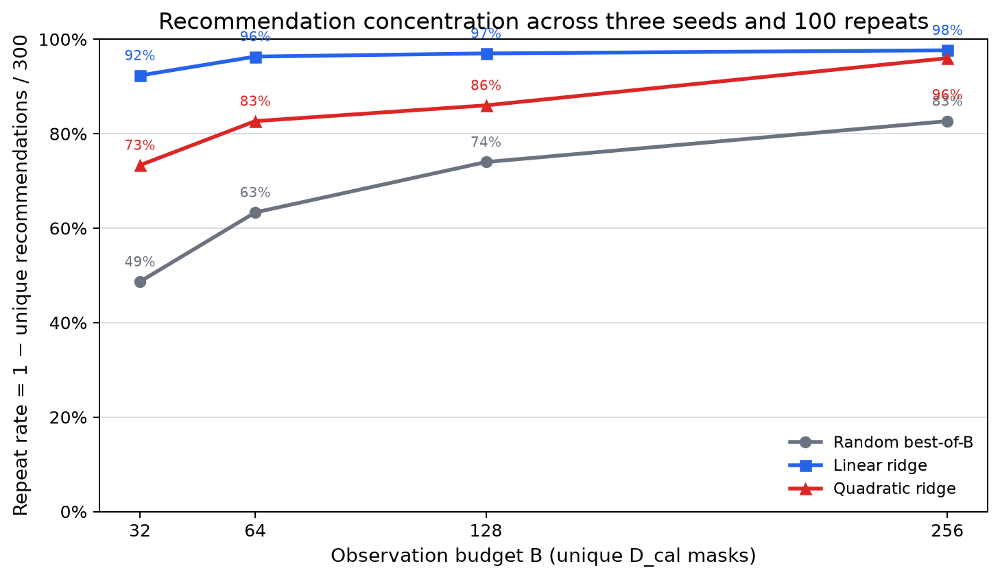
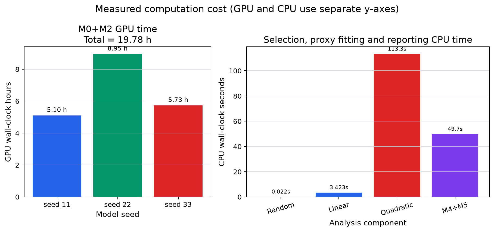
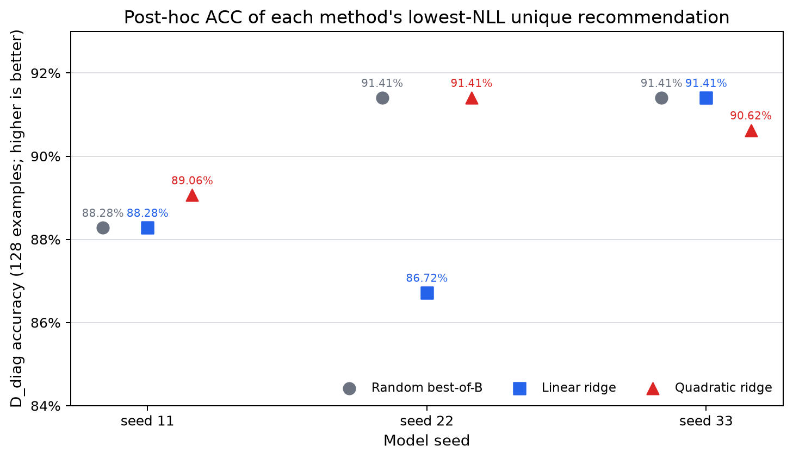

# LoRA 选层等预算随机搜索基线：完整实验报告

实验版本：`random_baseline_20261013_230844`  
主实验完成时间：2026-10-14 19:56（Asia/Shanghai）  
ACC 补充实验：`acc_top3_20261014_204524`  
最终状态：**SUPPORTS_PROXY_SELECTION**

## 1. 结论先行

本实验要回答的问题是：在完全相同的真实 mask 测量预算下，二次 Ridge 代理是否比“随机测量 B 个结构后，直接选择其中 D_cal 损失最低者”更能找到 D_diag NLL 较低的 LoRA 选层结构。

在预先指定的主预算 `B=256` 下，答案是肯定的：

| 模型 seed | Random 平均 D_diag NLL | Quadratic 平均 D_diag NLL | Random−Quadratic | 二次代理胜/平/负 |
|---:|---:|---:|---:|---:|
| 11 | 0.330606 | 0.318696 | **0.011911** | 61 / 15 / 24 |
| 22 | 0.327324 | 0.317375 | **0.009949** | 64 / 10 / 26 |
| 33 | 0.294757 | 0.280356 | **0.014401** | 80 / 9 / 11 |
| 三 seed 等权汇总 | 0.317562 | 0.305476 | **0.012087** | 205 / 34 / 61 |

主判断规则在看结果前已经冻结：三 seed 等权平均改善至少为 `0.005 NLL`，并且至少 2 个 seed 的方向为正。实际改善为 `0.012087`，三个 seed 全部为正，因此得到 **SUPPORTS_PROXY_SELECTION**。

这项结论只适用于当前条件：Qwen2.5-1.5B、SST-2、16 个候选层中选择 4 个、共享 LoRA 权重、固定 D_cal/D_diag 划分。它不能直接推出独立重训练收益、跨任务泛化、量子必要性或量子优势。当前正面结果由经典二次 Ridge 得到，没有继续扩展量子方法的依据。

## 2. 为什么要做这次实验

此前的 16 选 4 实验已经显示二次代理存在正面信号，但每个模型 seed 只比较了一个固定随机结构。这样的随机对照太弱：一个随机结构表现不好，不能证明代理优于“把同样的真实评估预算用于随机搜索”。

历史独立重训练的三 seed 均值为：linear Accuracy 0.940367、NLL 0.178329；quadratic Accuracy 0.945336、NLL 0.165379；固定随机结构 Accuracy 0.947630、NLL 0.165917。这些结果是研究背景，不参与本次共享权重 D_diag 判断。尤其不能把历史独立重训练指标与本实验的共享 checkpoint NLL 混为一谈。

因此，本次把随机基线加强为严格的 **Random best-of-B**：随机无放回测量 B 个结构，只根据这 B 个结构的 D_cal NLL 选择其中最好的一个，然后与使用同一批 B 条观测训练的线性、二次代理进行公平比较。

### 2.1 第一轮：8选4前期验证

第一轮使用候选层 `[0,4,8,12,15,19,23,27]`，固定选择 4 层，共 70 个合法结构。二次模型通过全零、8 个单层和 28 个双层锚点，共 37 个 mask，外推四层结构；主设置使用 64 条 D_cal 文本。

| seed | Linear Spearman | Quadratic Spearman | Linear regret | Quadratic regret |
|---:|---:|---:|---:|---:|
| 11 | 0.671385 | 0.557694 | 0.015231 | 0.015231 |
| 22 | 0.780877 | 0.465349 | 0.029706 | 0.054373 |
| 33 | 0.829621 | 0.122841 | 0.003682 | 0.053203 |

二次模型把平均数值 MAE 从约 0.317 降到 0.080，却在三个 seed 上都降低了排序相关性，结构选择 regret 也没有改善。70 个结构的经典精确枚举只需约 0.00034 秒，局部搜索和模拟退火也达到零 regret。因此第一轮同时得到 `NO_GO_PROXY` 和 `NO_GO_SEARCH`，没有进入独立重训练和量子阶段。

### 2.2 第二轮：16选4目标基数拟合

第二轮把空间扩大到 1,820 个结构，并修正第一轮最可疑的环节：不再用零层、单层和双层损失外推四层结构，而是直接测量四层 mask，使用 32/64/128/256 个 mask 拟合正则化代理。二次 Ridge 在 B=64、128、256 的选层指标上超过 Linear，并获准进行独立 fresh-adapter 重训练。

官方 SST-2 dev 的独立重训练结果中，Quadratic 相对 Linear 的三 seed 平均 NLL 改善为 0.012949，超过冻结门槛 0.01；Accuracy 平均提高 0.4969 个百分点，略低于 0.5 个百分点门槛。固定随机结构仍然很强，因此当时只能说明二次目标相对线性目标有可迁移 NLL 信号，不能说明它优于等预算随机搜索。

### 2.3 16选6和量子阶段为何停止

16选6共有 8,008 个结构。先导计时预计完整实验还需约 22.98 GPU 小时，保守估计 28.73 小时，超过当时剩余预算，因此按协议以 `INCONCLUSIVE_BUDGET` 停止。项目没有运行 QAOA、量子退火、量子模拟器或付费 QPU。

本次等预算随机搜索实验正是研究链条中的下一步：它不再与一个固定随机结构比较，而是让随机搜索和代理共享完全相同的 B 次真实观测，从而直接检验代理的泛化是否值得。

## 3. 实验设置

### 3.1 模型、任务和结构空间

| 项目 | 设置 |
|---|---|
| 基础模型 | Qwen/Qwen2.5-1.5B，revision `8faed761...` |
| 任务 | GLUE SST-2 二分类 |
| 模型 seed | 11、22、33 |
| 候选 Transformer blocks | `[0,1,2,3,4,6,8,10,12,15,17,19,21,23,25,27]` |
| mask 含义 | 第 i 位控制对应候选 block 的 `q_proj` 和 `v_proj` LoRA |
| 固定基数 | 每个 mask 恰好启用 4 个候选层 |
| 合法结构数 | C(16,4)=1,820 |
| LoRA | rank 4，alpha 8，q_proj/v_proj，其他训练设置固定 |

mask 是一个 16 位二进制开关。例如某一位为 1，表示在该候选 block 的 q_proj 和 v_proj 上启用已经训练好的共享 LoRA；为 0 则关闭。所有方法都在同一个 1,820 结构空间中选择。

### 3.2 数据划分

每个 seed 都使用自己的固定数据索引：`D_train=2048`、`D_cal=256`、`D_diag=128`、`D_select=512`、`D_final=512`。本实验只使用共享 checkpoint、D_cal 和 D_diag：

- **D_cal**：测量被观察 mask 的真实 gold-label NLL、训练代理、选择 Ridge 正则强度和产生推荐。
- **D_diag**：推荐完全冻结之后，统一评估推荐结构的真实平均 gold-label NLL。
- **D_diag 不参与选择**：M3 访问审计记录了 1,200 个 seed×重复×预算事件，全部恰好只打开 B 个 D_cal 标签，打开 D_diag 文件数为 0。

三个 seed 同时改变数据划分、LoRA 初始化和 warm-up 顺序，因此它们代表三个固定实验条件，不是纯训练方差，也不能把每个 seed 下的 100 次随机 mask 抽样解释成 100 次独立模型训练。

### 3.3 三种方法

对每个 seed、重复 r 和预算 B，三种方法共享完全相同的观测集合 `O(seed,r,B)`：

1. **Random best-of-B**：在 O 中选择实测 D_cal NLL 最低的 mask。
2. **Linear Ridge**：用 16 个层开关作为特征，根据 O 中 B 条 D_cal 观测拟合 Ridge，再在全部 1,820 个合法 mask 中选择预测 NLL 最低者。
3. **Quadratic Ridge**：使用 16 个一次项和 120 个两两交互项，共 136 个特征；其余流程与 Linear 相同。

代理可以推荐观测集合外的结构，这正是代理可能产生的泛化价值。正则强度只使用当前 B 条观测做固定四折 mask 维交叉验证；候选 alpha 为 `[1e-6,...,1000]`。预测分数并列时取整数 mask 较小者。

### 3.4 采样与重复

预算为 `B=32、64、128、256`，主预算预先指定为 256。每次重复先从 1,820 个合法结构中均匀、无放回生成一条 256-mask 序列，小预算使用同一序列的嵌套前缀。每个模型 seed 进行 100 次重复。

三个 seed 的全部 1,820 个 D_diag mask 原先已经缓存；本实验又补齐了每个 seed 缺失的 1,564 个 D_cal mask，共新增 4,692 个真实 mask 测量。完整缓存并不意味着某次代理可以查看 1,820 个标签；访问隔离保证每个比较仍然只使用规定的 B 条 D_cal 观测。

## 4. 指标和判断方法

主指标是推荐结构在 D_diag 上的平均 gold-label NLL，越低越好。二次代理相对随机搜索的配对改善定义为：

`Δ_QR(B,r) = L_diag(random) − L_diag(quadratic)`。

因此，`Δ_QR>0` 表示二次代理更好。类似地：

- `Δ_LR = L_diag(random) − L_diag(linear)`；
- `Δ_QL = L_diag(linear) − L_diag(quadratic)`。

胜、平、负以 `±1e-10` 为数值平局边界。每个 seed 内对 100 个配对重复做 10,000 次 bootstrap，得到均值改善的 95% 区间；胜率使用 Wilson 95% 区间。这些区间描述固定模型和固定文本下“换一批随机观测 mask”造成的不确定性。

由于所有 1,820 个 D_diag 标签完整，还计算了 simple regret：

`regret(z)=L_diag(z)−min_{u∈合法空间}L_diag(u)`。

全空间最优值只用于推荐冻结后的事后评分，从未参与推荐。

## 5. 主实验结果

### 图1：三个 seed 合并后的预算曲线

**图中内容。** 横轴是每次允许使用的真实 D_cal mask 数量 B；纵轴是推荐结构在 D_diag 上的平均 NLL，越低越好。每个点汇总三个 seed、每个 seed 100 次重复，共 300 个推荐结果。灰色是 Random，蓝色是 Linear，红色是 Quadratic。

**具体数值。**

| B | Random | Linear | Quadratic | Random−Quadratic |
|---:|---:|---:|---:|---:|
| 32 | 0.338955 | 0.343366 | **0.329290** | 0.009665 |
| 64 | 0.330258 | 0.342985 | **0.319739** | 0.010519 |
| 128 | 0.324260 | 0.344691 | **0.311903** | 0.012357 |
| 256 | 0.317562 | 0.346143 | **0.305476** | 0.012087 |

**如何解读。** 随着预算增加，随机搜索因为看到更多候选而持续改善；二次代理也随数据增多而改善，并在四个预算上都取得最低的合并平均 NLL。线性代理的合并曲线没有随预算改善，原因不是所有 seed 都失败，而是 seed 22 和 33 出现了高度集中的坏推荐，后面的分 seed 图会显示这一点。

**限制。** 合并均值等权混合了三个不同 checkpoint 和数据划分，会隐藏 seed 间差异。因此主结论不能只看这张图，必须同时看图2–4和配对差值。

### 图2：seed 11 的预算曲线

**图中内容。** 坐标和颜色与图1相同，但只包含 seed 11 的 100 次随机观测集合。

| B | Random | Linear | Quadratic |
|---:|---:|---:|---:|
| 32 | 0.363655 | **0.321549** | 0.341864 |
| 64 | 0.350050 | **0.317492** | 0.327501 |
| 128 | 0.340137 | **0.316389** | 0.325794 |
| 256 | 0.330606 | **0.317015** | 0.318696 |

**如何解读。** seed 11 中，Linear 在所有预算下都是平均最优；Quadratic 虽然没有超过 Linear，但始终优于 Random。到 B=256 时，Quadratic 比 Random 改善 0.011911 NLL，但比 Linear 差 0.001681。这说明本实验支持的是“Quadratic 优于等预算 Random”，并不意味着 Quadratic 在每个 seed 上都优于 Linear。

**限制。** 曲线是 100 次 mask 抽样的均值，并不表示任意单次抽样都保持相同顺序；图6显示 seed 11 的二次代理胜率在 B=256 为 61%，而不是 100%。

### 图3：seed 22 的预算曲线

**图中内容。** 横轴为 D_cal 观测预算，纵轴为 seed 22 的平均 D_diag NLL；灰、蓝、红依次表示 Random、Linear、Quadratic，每个点来自 100 次共享观测集合的重复。

| B | Random | Linear | Quadratic |
|---:|---:|---:|---:|
| 32 | **0.337529** | 0.374476 | 0.340975 |
| 64 | **0.333487** | 0.375091 | 0.335612 |
| 128 | 0.331792 | 0.375091 | **0.322557** |
| 256 | 0.327324 | 0.375091 | **0.317375** |

**如何解读。** seed 22 是预算效应最明显的例子。B=32、64 时，Quadratic 与 Random 接近且均值略差；达到 B=128 后，Quadratic 开始明确优于 Random。Linear 几乎总是推荐同一个 mask 7680，D_diag NLL 为 0.375091，导致曲线基本不动。这表明 16 个一次项不足以描述该 seed 的结构损失面，而交互项在观测达到一定数量后有明显价值。

**限制。** “B=128 后更好”是这组固定条件下的趋势，不能据此声明 128 是其他任务或模型的通用最低预算。

### 图4：seed 33 的预算曲线

**图中内容。** 横轴为 D_cal 观测预算，纵轴为 seed 33 的平均 D_diag NLL；三种颜色和统计口径与图2、图3相同，每个方法在每个预算都有 100 个配对结果。

| B | Random | Linear | Quadratic |
|---:|---:|---:|---:|
| 32 | 0.315682 | 0.334073 | **0.305032** |
| 64 | 0.307238 | 0.336372 | **0.296104** |
| 128 | 0.300850 | 0.342594 | **0.287358** |
| 256 | 0.294757 | 0.346321 | **0.280356** |

**如何解读。** seed 33 中，Quadratic 在四个预算上都最优，而且随预算增加稳定下降。Linear 反而逐步恶化，说明更多观测并不能修复错误的函数形式；当真实损失依赖层与层的配合时，一次模型可能稳定地外推到错误区域。

**限制。** seed 33 的结果很强，但主结论没有只依赖这一 seed；seed 11、22 的平均方向也为正。

### 图5：B=256 的二次代理配对改善区间

**图中内容。** 每个圆点是一个 seed 下 100 次配对重复的平均 `Random−Quadratic` NLL；竖线是对重复序列做配对 bootstrap 得到的 95% 区间。水平实线为 0，表示两者平均持平；红色虚线为预先批准的实用门槛 0.005。

| seed | 平均改善 | mask抽样95%区间 |
|---:|---:|---:|
| 11 | 0.011911 | [0.008486, 0.015320] |
| 22 | 0.009949 | [0.006050, 0.013744] |
| 33 | 0.014401 | [0.012131, 0.016717] |

**如何解读。** 三个 seed 的均值和区间都在 0 以上，而且区间下界也高于 0.005。这说明正向结果并非只由少数极端随机序列造成。另一个按 D_diag 文本重采样的敏感性分析也得到正区间：seed 11 `[0.001895,0.021074]`、seed 22 `[0.002283,0.019090]`、seed 33 `[0.007920,0.021399]`。

**限制。** 图中的窄区间只描述固定 checkpoint、固定 D_diag 文本下更换 mask 观测集合的不确定性，不是跨模型、跨任务或独立训练的置信区间。文本 bootstrap 区间和 mask bootstrap 区间也不应合并成一个“总体泛化区间”。

### 图6：二次代理相对随机搜索的胜率

**图中内容。** 横轴为预算，纵轴为 100 次重复中 `Quadratic NLL < Random NLL` 的比例。水平虚线为 50%。三条线分别对应 seed 11、22、33；平局仍计入总重复数，但不计为胜利。

| seed | B=32 | B=64 | B=128 | B=256 |
|---:|---:|---:|---:|---:|
| 11 | 64% | 76% | 67% | 61% |
| 22 | 42% | 49% | 64% | 64% |
| 33 | 60% | 71% | 79% | 80% |

**如何解读。** seed 22 清楚展示了二次模型需要更多观测：小预算时胜率不超过一半，B≥128 后上升到 64%。seed 33 随预算稳定上升。seed 11 的胜率不单调，说明增加预算并不保证每一条随机序列都更有利，但平均 NLL 改善仍为正。B=256 合并三 seed 后为 205 胜、34 平、61 负，胜率 68.33%。

**限制。** 胜率只看方向，不看改善幅度。一次很小的胜利和一次很大的胜利都各计 1，因此需要与图5的平均改善共同判断。

### 图7：推荐重复率

**图中内容。** 重复率定义为 `1−唯一推荐mask数/推荐次数`。值越高，表示不同随机观测集合最终越集中到少数几个结构。图中使用三个 seed 合并后的 300 个推荐记录；相同 mask 编码跨 seed 会计为同一个结构编号。

| 方法 | B=32 | B=64 | B=128 | B=256 |
|---|---:|---:|---:|---:|
| Random | 48.67% | 63.33% | 74.00% | 82.67% |
| Linear | 92.33% | 96.33% | 97.00% | 97.67% |
| Quadratic | 73.33% | 82.67% | 86.00% | 96.00% |

**如何解读。** Random 随预算增大更容易包含同一批强结构，因此重复率上升。Linear 很早就高度集中，这并不代表它稳定正确：seed 22 的 Linear 正是稳定地推荐了坏结构。Quadratic 在小预算时探索范围较广，B=256 时高度集中。按 seed 看，B=256 的 Quadratic 重复率分别为 97%、94%、96%。

**限制。** 重复率衡量集中程度，不衡量质量；高重复率既可能是可靠收敛，也可能是系统性偏差。跨 seed 汇总还会把同一 mask 编码视为相同结构，即使其损失来自不同 checkpoint，因此应结合分 seed NLL 解读。

### 图8：实测计算成本

**图中内容。** 图分成左右两个面板。左图以小时为纵轴，分别给出三个模型 seed 的 M0复核+M2补测 GPU 墙钟时间，并标出总计；右图以秒为纵轴，展示 Random、Linear、Quadratic 和 M4/M5统计报告的 CPU 时间。分开纵轴是为了避免约20小时的GPU成本把几秒到几分钟的CPU柱压到看不见。

| 项目 | 实测时间 |
|---|---:|
| GPU M0+M2 | 19.7834 小时 |
| Random CPU | 0.022 秒 |
| Linear CPU | 3.423 秒 |
| Quadratic CPU | 113.290 秒 |
| M4+M5 CPU | 49.717 秒 |

**如何解读。** 几乎全部成本来自补齐 4,692 个真实 D_cal mask。代理拟合和完整空间枚举相对便宜；Quadratic 比 Linear 的 CPU 成本高约 33 倍，但总计仍不到 2 分钟。若未来已有完整 D_cal 缓存，重复随机序列和代理分析的边际成本很低。

**限制。** 左右面板使用不同单位和不同纵轴，柱高不能跨面板直接比较；应读取柱顶数值。这里记录的是本机墙钟时间，不应直接外推到不同 GPU、批大小或存储系统。

## 6. B=256 的进一步诊断

### 6.1 Simple regret

| seed | 全空间最优 D_diag NLL | Random 平均 regret | Linear 平均 regret | Quadratic 平均 regret |
|---:|---:|---:|---:|---:|
| 11 | 0.311609 | 0.018997 | **0.005406** | 0.007087 |
| 22 | 0.305572 | 0.021752 | 0.069519 | **0.011803** |
| 33 | 0.277370 | 0.017387 | 0.068952 | **0.002987** |

Quadratic 在 seed 22、33 最接近全空间最优；seed 11 则 Linear 更接近。全空间最优只用于事后评分，没有参与三种方法的选择。

### 6.2 代理是否真的在外推

B=256 时，Linear 推荐落在当前 256 个已观测 mask 内的比例分别为 13%、18%、13%；Quadratic 分别为 15%、12%、9%。也就是说，绝大多数代理推荐来自未观测的合法结构，结果确实检验了代理从少量真实测量向完整结构空间外推的能力，而不是简单复述已测最优。

### 6.3 与 Linear 的关系

三 seed 合并后，B=256 的 `Random−Linear` 平均值为 `−0.028580`，即 Linear 总体比 Random 更差；`Linear−Quadratic` 为 `0.040667`，Quadratic 总体明显优于 Linear。分 seed 看，Linear 在 seed 11 很好，但在 seed 22、33 稳定失败。因此，二次项的价值主要体现在减少一次模型的跨 seed 失效，而不是保证每个 seed 都超过 Linear。

### 6.4 原平衡观测集合补充对照

原实验的观测集合是为了平衡层频次和层对共现而设计，不是全空间均匀随机样本，因此只作为补充：

| seed | B=256 已观测实测最优 | Linear | Quadratic |
|---:|---:|---:|---:|
| 11 | 0.328282 | **0.311609** | 0.317299 |
| 22 | 0.334628 | 0.375091 | **0.306360** |
| 33 | **0.277370** | 0.349651 | 0.279488 |

这组固定集合再次显示 Linear 的 seed 依赖性，也说明代理并非在每个 seed 上都优于“已有观测中的最优”。它没有参与主随机基线判定。

## 7. ACC 补充实验

主实验没有保存两类完整预测，只保存 gold-label NLL，因此无法从原缓存直接换算 ACC。补充实验在 B=256 下，对每种方法、每个 seed 的唯一推荐结构按 D_diag NLL 排序，取最多前三名，重新计算两个标签的序列 NLL和分类正确性。

这一步一共形成 24 个方法候选席位；去重后为 16 个 seed–mask 组合，GPU 用时 524.25 秒。重新计算的 gold-label NLL 与原缓存最大误差为 0。

### 图9：各方法 NLL Top-1 结构的 ACC

**图中内容。** 每组三个点对应一个模型 seed；灰色圆点、蓝色方块和红色三角分别为 Random、Linear、Quadratic。纵轴明确标出 D_diag Accuracy，范围为84%–93%，用于看清相差一两条样本的变化。这里的“Top-1”不是某一次预先冻结的推荐，而是事后从该方法100次 B=256 重复产生的所有唯一推荐中，选择 D_diag NLL 最低的结构。每个 ACC 使用同一 seed 的128条 D_diag 文本计算。

| seed | Random Top-1 | Linear Top-1 | Quadratic Top-1 |
|---:|---:|---:|---:|
| 11 | 88.28%（113/128） | 88.28%（113/128） | **89.06%（114/128）** |
| 22 | **91.41%（117/128）** | 86.72%（111/128） | **91.41%（117/128）** |
| 33 | **91.41%（117/128）** | **91.41%（117/128）** | 90.62%（116/128） |
| 三 seed 描述性均值 | **90.36%** | 88.80% | **90.36%** |

**如何解读。** Random 和 Quadratic 的三 seed Top-1 ACC 均值相同，但候选并不总是不同：seed 22 两者 Top-1 都是 mask 3585；seed 11 的 Random/Linear 都是 mask 5633；seed 33 的 Random/Linear 都是 mask 1601。Linear 的均值较低主要由 seed 22 的 mask 7680 造成。NLL 与 ACC 也不完全同序：seed 11 的 mask 5633 NLL 更低但 ACC 为 88.28%，mask 1793 NLL 稍高但 ACC 为 89.06%。原因是 NLL同时评价置信度，而 ACC 只判断最终类别是否正确。

**限制。** 这是明确的事后 oracle 描述：先用 D_diag NLL 选前三，再在同一个 D_diag 上看 ACC，不能据此建立新的无偏选择规则。每个 seed 只有128条文本，ACC每变化一条样本就是0.78125个百分点；一两个样本的差异不能过度解释。图的纵轴从84%开始而不是0%，便于读取小差异，但会在视觉上放大方法间距离，必须结合标注的百分比和正确数理解。完整 Top-3 表和逐样本预测见补充目录。

## 8. 正确性、隔离与可追溯性核验

- M0 元数据和历史结果复现通过；历史九条 Accuracy/NLL 汇总最大误差为 0。
- 每个 seed 确定性抽查 8 个旧 mask，共 24 个 BF16 前向复核，逐样本最大误差为 0，排序反转数为 0。
- M2 每个 seed 新增 1,564 个 D_cal mask，最终每个 seed 的 1,820 个 D_cal 和 1,820 个 D_diag 均完整。
- M3 推荐共 3,600 条；1,200 个比较事件全部只读取各自 B 个唯一 D_cal 文件，D_diag 访问数为 0。
- 推荐文件、协议、源码、访问审计和成本账本在评分前均已哈希冻结。
- 最终审计全部通过；RUN_MANIFEST 中 4,736 个文件逐一复核，缺失、大小不符和 SHA-256 不符均为 0。
- ACC 补充实验保存 16 个原始 NPZ，每个含 `(128,2)` 两类 NLL、标签、预测与逐样本正确性；补充审计通过。

## 9. 最终解释

在当前共享权重诊断条件下，二次 Ridge 确实比等预算随机搜索更有效。优势在三个 seed 上方向一致，B=256 的平均改善超过预先设定的实用门槛，mask 抽样区间也全部为正。二次代理的推荐大多位于未观测集合之外，说明它获得的不是单纯“从已测结构里挑最好”的收益。

同时，结果也揭示了边界：二次代理不是每次重复都赢，也不是每个 seed 都优于线性代理；NLL更好也不保证 ACC 更高。ACC 补充结果显示 Random 与 Quadratic 的事后 Top-1 ACC 均值相同，因此当前最稳妥的表述是：**二次代理提高了共享权重条件下的结构 NLL 选择质量，但尚未证明它提高独立重训练后的分类准确率。**

由于经典二次 Ridge 已在这个规模上达到正面且计算便宜的结果，本项目目前应停止量子扩展。后续若继续，优先级应是对预先冻结的结构进行独立 LoRA 重训练、扩大模型/任务/数据 seed 覆盖，并使用独立测试集验证 NLL 和 ACC，而不是引入量子优化器。

## 10. 主要文件

- `approved_protocol.json`：冻结协议。
- `sampling_sequences.json`、`fold_ids.json`：抽样序列和交叉验证折。
- `selection_freeze.json`、`recommendations.jsonl`：冻结推荐及哈希。
- `paired_metrics.csv`：1,200 条 seed×重复×预算配对结果。
- `seed_summary.csv`、`paired_delta_summary.csv`：方法和差值汇总。
- `bootstrap_intervals.json`、`diag_text_bootstrap.json`：两类不确定性分析。
- `selection_diagnostics.csv`：推荐是否属于观测集合及方法重合率。
- `balanced_observed_best_supplement.csv`：原平衡集合补充对照。
- `cost_summary.json`：实测成本。
- `FINAL_AUDIT.json`、`RUN_MANIFEST.json`：最终审计和文件清单。
- `supplements/acc_top3_20261014_204524/`：ACC 补充实验的报告、CSV、原始预测和审计。

